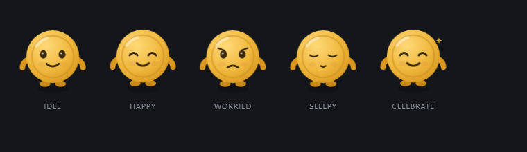

# trove

**A personal finance app that runs on your computer, with no account and no server.**

## Why another finance app

Because the existing ones want your bank password, a cloud account and a subscription. This one goes the other way: you import the OFX file the bank **already gives you**, and the data stays in a SQLite file on your machine.

The rule is simple: every number on screen answers "where did this come from". Each entry keeps the file and the line that produced it.

## Install

Download from the [releases](https://github.com/LucasInstra/trove/releases) page:

- `trove_0.1.2_x64_en-US.msi` — the installer (updates arrive through it too)
- `trove_0.1.2_x64-setup.exe` — NSIS installer alternative
- `trove-portable-x64.zip` — the executable alone, for when you do not want to install anything

Updates are automatic: the app checks on launch and offers the install from Settings. The build is not code signed, so Windows SmartScreen may warn on first run.

## What it does

- **A dashboard that is yours.** Drag cards anywhere in the grid with a live preview, set each card's width in columns, and pick how much detail it shows: compact, minimised or expanded. A wide card shows more of it, not the same content stretched.
- **Transactions of their own.** The ledger lives in its own tab, with search by description, merchant or category, and the category editable right on the row.
- **Cash flow and planning.** A cash-flow screen plus planning tabs for cards, reserve, home and income.
- **Where the money went.** A spending breakdown bar with the category on hover, and a six-month series behind it.
- **OFX import**, by dragging the file or picking it from the computer. Reads both the SGML dialect of OFX 1.x and the XML one of OFX 2.x, several files at once. Reimporting the same period duplicates nothing: entries are matched by `FITID` when the bank keeps it stable, by fingerprint when it does not.
- **Clean merchant names**: `IFD*IFOOD SAO PAULO` becomes `IFOOD SAO PAULO`.
- **Month navigation** with in, out and net computed locally, opening on the most recent month that has data.
- **Import history**: every file that ever entered the ledger, with how many entries it added and how many were already there.
- **English and Portuguese**, switched in Settings and remembered between launches.

## The keeper

A piggy bank with a face guards the trove. It follows the pointer, blinks, looks around when nothing is happening and hops when you boop it. The mood follows the month: happy when you spend less than you earn, worried when the month closes negative, sleepy when there is nothing imported yet, celebrating when a statement lands.

Click **Customize** in the sidebar to change the shape, the colour and the eyes, and to turn the snout, ears, curl tail and blush on or off. The look is stored locally.

## Privacy

No financial data leaves the computer. There is no login, no telemetry and no request to a server of ours; the only network call is the update check against GitHub. The database lives in `%APPDATA%\com.lucas.trove\trove.db`, and Settings shows the folder.

## Roadmap

- [x] OFX import, deduplication, ledger and categories
- [x] Rearrangeable dashboard, transactions tab and planning tabs
- [x] Spending breakdown and cash flow
- [ ] CSV with per-bank column mapping
- [ ] Subscription radar and price-increase alerts
- [ ] Receipts with OCR, tax tags and a dossier for the accountant
- [ ] Brokerage notes, positions and a net-worth curve

## For developers

Run from source, checks, the release process and the code map live in [docs/development.md](docs/development.md). To try the app without a bank statement, drag [`fixtures/sample.ofx`](fixtures/sample.ofx) onto the Import screen — importing it twice should report all eight entries as already there.

## License

MIT. See [LICENSE](LICENSE).
